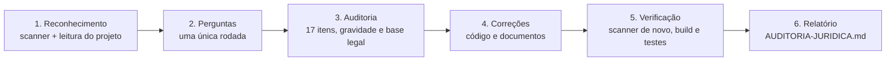

<div align="center">

# ⚖️ Blindagem Jurídica

**Skill para Claude Code que audita e corrige os riscos jurídicos do seu site, loja ou app, pela lei brasileira.**

LGPD · CDC · cookies · acessibilidade · publicidade · direitos autorais

[](https://github.com/Kazualkun/BlindagemJur-dica/actions/workflows/testes.yml)
[](LICENSE)


[Instalação](#-instalação) · [Como usar](#-como-usar) · [O que verifica](#-o-que-ela-verifica) · [Limitações](#-limitações)

</div>

---

A skill lê o código do seu projeto, encontra o que pode render **multa, reclamação no Procon ou processo**, corrige o que é técnico, gera os documentos legais **sob medida** e **pergunta** o que só você pode responder.

> [!WARNING]
> A skill reduz riscos de forma técnica e automatizada, mas **não substitui um(a) advogado(a)**. Documentos contratuais e casos de alto risco devem passar por revisão jurídica.

## ✨ Destaques

- 🔍 **Audita código real**, não um questionário. A política de privacidade é montada a partir dos rastreadores, fornecedores e campos de formulário que existem no seu projeto.
- 🛠️ **Entrega feito**: alt, contraste, teclado, banner de cookies, formulários, rodapé com dados da empresa e documentos legais.
- ❓ **Pergunta o que não sabe**: CNPJ, encarregado (DPO), prazos de troca, se os depoimentos são reais, origem das imagens. Nunca inventa dado.
- 🧑‍⚖️ **Decisões de negócio ficam com você**: depoimentos, promessas, imagens e campos de formulário só mudam com a sua aprovação.
- 📎 **Cada achado vem com evidência** (`arquivo:linha`), gravidade e base legal.
- 🧩 **Banner de cookies pronto** que também funciona sozinho, em JS puro.

## 📋 O que ela verifica

<table>
<tr><th>Grupo</th><th>Itens</th></tr>
<tr><td><b>📄 Documentos legais</b></td><td>Política de privacidade · Termos de uso · Política de reembolso</td></tr>
<tr><td><b>🍪 Cookies e dados</b></td><td>Aviso de cookies · Scripts de tracking · Formulários na LGPD · Só dados necessários · Conformidade LGPD</td></tr>
<tr><td><b>♿ Acessibilidade</b></td><td>Acessibilidade geral · Alt nas imagens · Contraste · Navegação por teclado</td></tr>
<tr><td><b>📣 Publicidade</b></td><td>Sem avaliações falsas · Sem promessas falsas</td></tr>
<tr><td><b>🏢 Empresa e propriedade</b></td><td>Dados da empresa · Copyright das imagens · Outros riscos jurídicos</td></tr>
</table>

<details>
<summary><b>Ver os 17 itens em detalhe</b></summary>

| # | Item | O que procura e corrige |
|---|------|------------------------|
| 1 | **Política de privacidade** | Existe, está linkada e **bate com o código** (rastreadores, fornecedores e campos reais) |
| 2 | **Termos de uso** | Conteúdo mínimo, aceite no cadastro, cláusulas abusivas (CDC art. 51) |
| 3 | **Aviso de cookies** | Bloqueio prévio, botão rejeitar, categorias, revogação, consentimento tácito |
| 4 | **Política de reembolso** | Arrependimento de 7 dias (CDC art. 49), vício, frete, prazos de estorno |
| 5 | **Formulários na LGPD** | Aviso no ponto de coleta, checkbox pré-marcado, consentimentos agrupados, HTTPS |
| 6 | **Só dados necessários** | CPF, nascimento, gênero, dados sensíveis sem necessidade |
| 7 | **Scripts de tracking** | GA4, GTM, Meta Pixel, TikTok, Hotjar, Clarity… sem consentimento; Consent Mode v2 |
| 8 | **Acessibilidade** | `lang`, zoom, rótulos, botões de ícone, legendas, iframes (LBI art. 63, NBR 17225) |
| 9 | **Alt nas imagens** | Imagens sem `alt` ou com `alt` genérico |
| 10 | **Contraste** | Pares cor/fundo em CSS, inline e Tailwind, com **sugestão de cor que passa** |
| 11 | **Navegação por teclado** | `div` clicável, foco removido, `tabindex` positivo, skip link |
| 12 | **Sem avaliações falsas** | Avatares gerados, `faker`, `aggregateRating` fixo, prova social sem lastro |
| 13 | **Sem promessas falsas** | "Resultado garantido", cura, lucro, escassez falsa, contador com `Math.random()` |
| 14 | **Copyright das imagens** | Bancos pagos, hotlinks, metadados EXIF, fontes comerciais, marcas de terceiros |
| 15 | **Dados da empresa** | Razão social, CNPJ (valida dígitos, inclusive o **CNPJ alfanumérico**), endereço, contato |
| 16 | **Conformidade LGPD** | Canal do titular, encarregado, exclusão de conta, hash de senha, segredos expostos, IA, menores (ECA Digital) |
| 17 | **Riscos jurídicos** | Sorteios sem autorização, apostas, dark patterns, venda casada, e-mail sem descadastro, licenças copyleft |

</details>

## 🔄 Como ela trabalha



Cada achado recebe uma gravidade:

| | Gravidade | Exemplo |
|---|-----------|---------|
| 🔴 | **Crítico** | Pixel de publicidade carregando antes do consentimento, depoimento com foto gerada, segredo exposto |
| 🟠 | **Alto** | Sem política de reembolso em loja, imagem de banco pago, consentimento tácito |
| 🟡 | **Médio** | Campo de CPF sem justificativa, `lang` errado, formulário sem aviso de privacidade |
| 🔵 | **Baixo** | Sem skip link, `alt` genérico, link "clique aqui" |

O relatório final traz o placar antes/depois, o que foi corrigido, o que depende de você e as respostas guardadas para a próxima execução.

## 🚀 Instalação

**Requisito:** Python 3.9+ para o scanner. É opcional: sem Python, a skill varre com as ferramentas de busca do Claude, só que mais devagar.

<details open>
<summary><b>Opção 1: como plugin (recomendado)</b></summary>

No Claude Code:

```
/plugin marketplace add Kazualkun/BlindagemJur-dica
/plugin install blindagem-juridica@blindagem-juridica
```

</details>

<details>
<summary><b>Opção 2: skill pessoal (vale para todos os seus projetos)</b></summary>

```bash
git clone https://github.com/Kazualkun/BlindagemJur-dica.git

# macOS / Linux
cp -r BlindagemJur-dica/skills/blindagem-juridica ~/.claude/skills/

# Windows (PowerShell)
Copy-Item -Recurse BlindagemJur-dica\skills\blindagem-juridica $HOME\.claude\skills\
```

</details>

<details>
<summary><b>Opção 3: skill do projeto (compartilhada com o time via git)</b></summary>

Copie `skills/blindagem-juridica` para `.claude/skills/` na raiz do seu projeto.

</details>

## 💬 Como usar

Com o projeto aberto no Claude Code:

```text
/blindagem-juridica                 # auditoria completa + correções
/blindagem-juridica auditar         # só diagnóstico e relatório, sem alterar o projeto
/blindagem-juridica itens 3,7       # só cookies e rastreamento
/blindagem-juridica itens 8-11      # só acessibilidade
```

Ou peça em linguagem natural, que a skill é acionada sozinha:

> *"Meu site está dentro da LGPD?"*
> *"Cria a política de privacidade e o banner de cookies da loja."*
> *"Vou lançar a landing page amanhã, tem algo que pode dar processo?"*

Instalada como plugin, o comando leva o prefixo do plugin: `/blindagem-juridica:blindagem-juridica`.

### Usar só o scanner

```bash
# varredura completa em Markdown
python skills/blindagem-juridica/scripts/scan.py caminho/do/projeto

# saída em JSON, gravada em arquivo
python skills/blindagem-juridica/scripts/scan.py caminho/do/projeto --format json --saida achados.json

# contraste WCAG com sugestão de cor que passa
python skills/blindagem-juridica/scripts/contraste.py "#999" "#fff"   # 2.85:1, sugere #767676
```

<details>
<summary><b>Exemplo de saída</b> (projeto de teste em <code>tests/fixtures/loja-problematica</code>)</summary>

```text
### 3. Aviso e gestão de cookies
- 🔴 cookies-sem-consentimento Rastreadores/cookies não essenciais sem gestão de consentimento:
  Google Analytics, Meta Pixel (Facebook/Instagram), Hotjar. Precisam ser bloqueados até o
  aceite (LGPD arts. 7º I e 8º; Marco Civil art. 7º IX; Guia de Cookies da ANPD)
- 🟠 consentimento-tacito Consentimento tácito ('ao continuar navegando…') não é válido - `index.html:24`

### 13. Promessas e publicidade enganosa
- 🔴 prova-social-aleatoria Contador de pessoas/estoque/vagas gerado com Math.random() -
  informação falsa ao consumidor (CDC art. 37 e 66) - `index.html:70`
```

</details>

## 🍪 Banner de cookies incluído

O banner em [`templates/cookie-consent/`](skills/blindagem-juridica/templates/cookie-consent/) também pode ser usado sozinho, sem a skill:

- Sem dependências, em JS puro e CSS.
- Bloqueia scripts e iframes até o aceite.
- "Rejeitar não essenciais" no primeiro nível, com o mesmo destaque de "Aceitar".
- Escolha por categoria e link permanente de preferências no rodapé.
- Google Consent Mode v2 (padrão `denied`).
- Acessível por teclado, com foco preso no painel e `Esc` para fechar.

Veja o [guia de instalação do banner](skills/blindagem-juridica/templates/cookie-consent/README.md).

## 📦 O que vem na skill

```text
skills/blindagem-juridica/
├── SKILL.md                         # fluxo de trabalho e regras
├── scripts/
│   ├── scan.py                      # varredura heurística dos 17 itens (Markdown ou JSON)
│   └── contraste.py                 # razão de contraste WCAG + sugestão de cor
├── references/                      # requisitos legais, como auditar e como corrigir, por item
│   ├── base-legal.md                # LGPD, CDC, Decreto 7.962, LBI, Marco Civil, ECA Digital…
│   └── …
└── templates/
    ├── politica-de-privacidade.md
    ├── termos-de-uso.md
    ├── politica-de-cookies.md
    ├── politica-de-reembolso.md
    ├── declaracao-de-acessibilidade.md
    ├── registro-de-operacoes.md     # ROPA (LGPD art. 37)
    ├── plano-resposta-incidentes.md # Res. CD/ANPD 15/2024
    ├── relatorio-auditoria.md
    └── cookie-consent/              # banner de consentimento pronto
```

## ⚠️ Limitações

- O scanner é **heurístico**: aponta pistas com arquivo e linha, e a skill confirma lendo o código. Conteúdo vindo de CMS ou banco, tags configuradas dentro do Google Tag Manager e imagens sem metadados precisam de informação sua.
- O contraste só é calculado quando cor e fundo estão no mesmo seletor ou elemento. Fundos herdados são revisados manualmente pela skill.
- O foco é a legislação brasileira. Se você atende a União Europeia ou os EUA, a skill sinaliza GDPR, CCPA e ADA, mas recomenda análise específica.
- Normas mudam. A base legal foi revisada em outubro de 2026, e contribuições de atualização são muito bem-vindas.

## 🤝 Contribuindo

Quer atualizar uma lei, ensinar o scanner a reconhecer um novo rastreador ou reportar um falso positivo? Veja o [CONTRIBUTING.md](CONTRIBUTING.md). Para rodar os testes:

```bash
python -m unittest discover -s tests -v
```

Os testes usam dois sites de exemplo em `tests/fixtures/`: um cheio de problemas e um correto, que não pode gerar achados graves.

## 📄 Licença

[MIT](LICENSE). Os modelos de documentos podem ser usados e adaptados livremente, inclusive comercialmente. Nenhum modelo dispensa a adaptação ao seu negócio.
